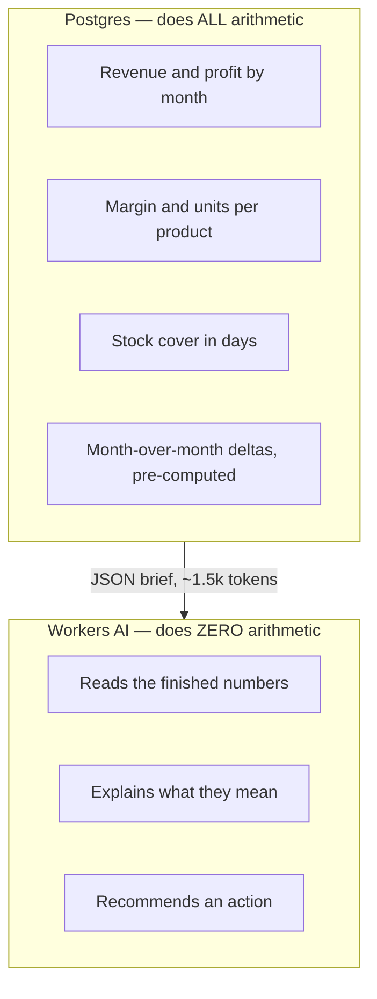
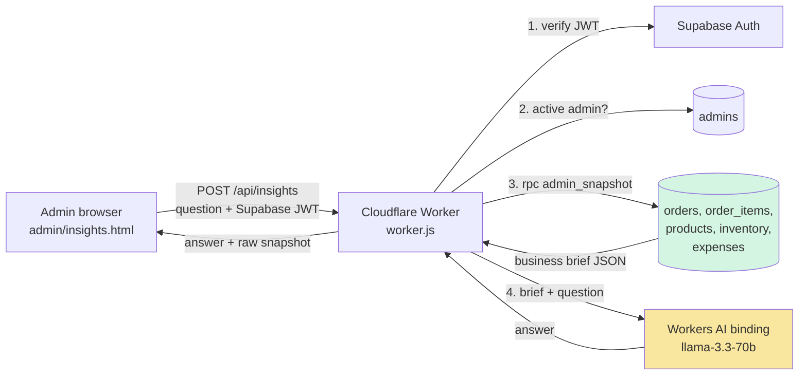
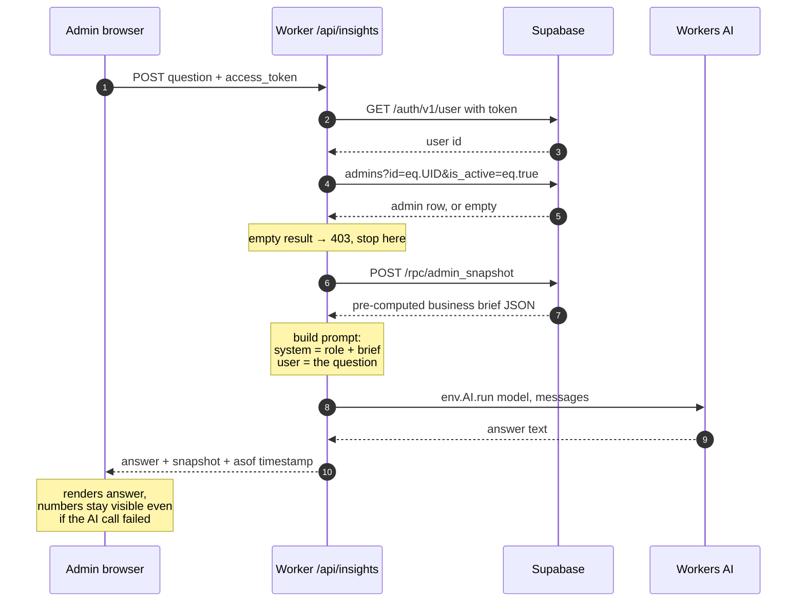
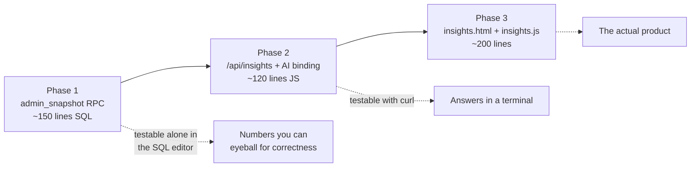

# NGL Admin Insights — Architecture Plan

**Status:** plan only, nothing built yet.
**Goal:** an admin-side assistant that answers business questions about NGL from live store data, so the owner can make decisions without reading six dashboards.

---

## 1. The thesis

This is **not RAG** in the embeddings sense, and it should not be.

RAG exists to solve one problem: *the facts don't fit in the prompt, so you must guess which ones to include.* That problem does not exist here. The entire business picture — 12 months of revenue, every product's margin and velocity, stock, expenses — compresses to roughly **1,500 tokens**. The model's context window is hundreds of times that.

So we skip retrieval entirely and paste the whole thing in. Same pattern the support bot already uses (`_support-core.js:169` stuffs `support_kb` into the prompt), just with a different blob.

The one rule that makes this work with a free, mid-sized model:

> **Postgres does all the arithmetic. The model does none of it.**

The model never sums, never divides, never computes a percentage change. It receives finished numbers and writes the interpretation. This is what lets an open 70B model be adequate for the job — we are asking it to *explain*, not to *calculate*.



If the model ever has to do math to answer a question, that is a bug in the snapshot — add the figure to the RPC instead of hoping the model gets it right.

---

## 2. System architecture



Everything reuses what already exists. The Worker already holds the service-role key and already talks to Supabase and an LLM — see the `/api/support` branch in `worker.js:78`. This is a sibling branch with different grounding and different auth.

---

## 3. Request flow



Note the last step. The snapshot is returned to the browser **alongside** the answer, so the page is still useful when the daily AI allocation runs out. The numbers are the product; the prose is the convenience layer.

---

## 4. The three pieces

### 4.1 `admin_snapshot()` — Postgres RPC

One `SECURITY DEFINER` function, guarded by the existing `public.is_admin()` (defined in `20260914000100_audit-fixes.sql:35`). Returns a single `jsonb`. New migration file.

Shape:

```jsonc
{
  "asof": "2026-09-19T08:00:00Z",
  "currency": "PHP",
  "months": [                      // last 12, oldest first
    { "month": "2026-09", "revenue": 48200, "profit": 19100,
      "orders": 62, "aov": 777, "revenue_mom_pct": -8.4 }
  ],
  "today":   { "revenue": 3100, "orders": 4, "pending": 2 },
  "products": {
    "top_by_revenue":  [ { "name": "Grace Pearl Drops", "units": 41, "revenue": 20500, "margin_pct": 61 } ],
    "top_by_margin":   [ "..." ],
    "slow_movers":     [ { "name": "...", "units_90d": 0, "stock": 14, "capital_tied": 4200 } ]
  },
  "inventory": {
    "low_stock":    [ { "name": "...", "stock": 2, "threshold": 5, "days_cover": 6 } ],
    "total_units": 412, "total_cost_value": 96300
  },
  "expenses": {
    "by_category_12mo": [ { "category": "Ads & Marketing", "amount": 18400, "pct_of_revenue": 9.2 } ],
    "last_month_total": 6200
  },
  "customers": {
    "repeat_rate_pct": 18.5, "new_last_30d": 44,
    "top_provinces": [ { "province": "Metro Manila", "orders": 120, "revenue": 71000 } ]
  },
  "orders_by_status": { "pending": 6, "paid": 19, "shipped": 11, "delivered": 402, "cancelled": 14 },
  "channel_split": { "online": { "orders": 380, "revenue": 240100 },
                     "pos":    { "orders": 72,  "revenue": 38400 } }
}
```

**Contains no customer PII.** No names, emails, phones or addresses — aggregates only. This is deliberate: the blob leaves our infrastructure on every request, so it must not carry anything identifying.

`cancelled` and `voided` orders are excluded from every revenue and profit figure, matching what `dashboard.js:93` already does client-side.

### 4.2 `/api/insights` — Worker endpoint

A branch in `worker.js` next to the existing `/api/support` one, with its core logic in `functions/api/_insights-core.js` so the Vite dev middleware can reuse it exactly as `_support-core.js` is reused today.

Differences from the support endpoint:

| | `/api/support` | `/api/insights` |
|---|---|---|
| Caller | anonymous customer | authenticated admin |
| Auth | per-conversation `access_token` | Supabase JWT → `admins` lookup |
| Grounding | `support_kb` text + one order | `admin_snapshot()` JSON |
| History | persisted in `support_messages` | in-memory, request body only |
| Model | Gemini (external key) | Workers AI (`env.AI` binding) |

The `askLLM()` function is the only provider-specific code — about 20 lines. Swapping to a paid provider later means editing that one function.

### 4.3 `admin/insights.html` + `src/insights.js`

The chat UI from `src/support-admin.js`, stripped of the realtime/queue machinery, pointed at the new endpoint. Sidebar entry goes in the `Overview` section in `admin.js:44`, after Dashboard.

Ships with 4–5 canned starter questions as buttons, because a blank chat box invites bad questions:
- "What should I restock before December?"
- "Which products tie up capital without selling?"
- "Where did last month's profit go?"
- "Which collection is actually carrying the business?"

---

## 5. Model and cost

`@cf/meta/llama-3.3-70b-instruct-fp8-fast` via the `ai` binding — no API key, no new vendor account, no billing relationship.

Cloudflare gives **10,000 Neurons/day free** on every plan, resetting 00:00 UTC. On the free plan a request that would exceed it **fails with an error rather than billing you** — which is exactly the behaviour you want.

Per question, at ~2,500 tokens in and ~600 out:

| Model | Neurons/question | Free questions/day |
|---|---|---|
| `llama-3.3-70b-instruct-fp8-fast` | ~190 | **~52** |
| `llama-3.1-8b-instruct-fp8` | ~31 | ~320 |

Start on 70B. If the daily cap ever bites, the fallback is a config change, not a rewrite.

---

## 6. Security

| Risk | Control |
|---|---|
| Service-role key exposure | Never leaves the Worker. The browser sends only its own user JWT. |
| Non-admin calling the endpoint | JWT verified server-side against Supabase Auth, then checked against `admins.is_active`. Identity is never read from the request body. |
| Model-authored SQL / data exfiltration | No text-to-SQL. One fixed RPC with a fixed output shape. The model cannot request different data. |
| Customer PII reaching an inference provider | Snapshot is aggregates only, by construction. |
| Cost or quota abuse by a logged-in admin | Rate limit per admin id, same pattern as `_support-core.js:157`. |

---

## 7. Failure modes

| What breaks | What the admin sees |
|---|---|
| Daily neuron allocation exhausted | "AI summary unavailable until 00:00 UTC" — the snapshot numbers still render. |
| Workers AI times out or errors | Same as above. The page degrades to a dashboard, never to a blank screen. |
| Snapshot RPC fails | Honest error. No prompt is sent, because an ungrounded answer is worse than no answer. |
| Model invents a number | Prevented by design, not by prompt-begging: the system prompt states that every figure must be quoted from the brief, and the brief is shown on-screen next to the answer so a fabrication is visible. |

---

## 8. Build order

Each phase is independently useful and independently testable.



**Phase 1 is the one that matters.** If the snapshot numbers are wrong, every later phase produces confident, well-written lies. Verify the RPC output against the existing dashboard KPIs before wiring any model to it.

---

## 9. Explicitly out of scope

Listed so it is a decision, not an oversight.

| Not building | Add it when |
|---|---|
| pgvector / embeddings | The free-text tables — `support_messages`, `contact_messages`, `reviews`, `community_posts` — outgrow the context window. Today that is ~20k tokens against a window hundreds of times larger. |
| Text-to-SQL | Never, on a service-role connection. If a question needs data the snapshot lacks, widen the snapshot. |
| Persisted conversation history | Admins ask one-shot questions. Add an `insights_threads` table if they start asking follow-ups that matter. |
| Scheduled weekly digest email | The chat works first. Resend is already wired up in `_support-core.js:96` when you want it. |
| Charts in the answer | The dashboard already has Chart.js. Link to it rather than rebuilding it. |
