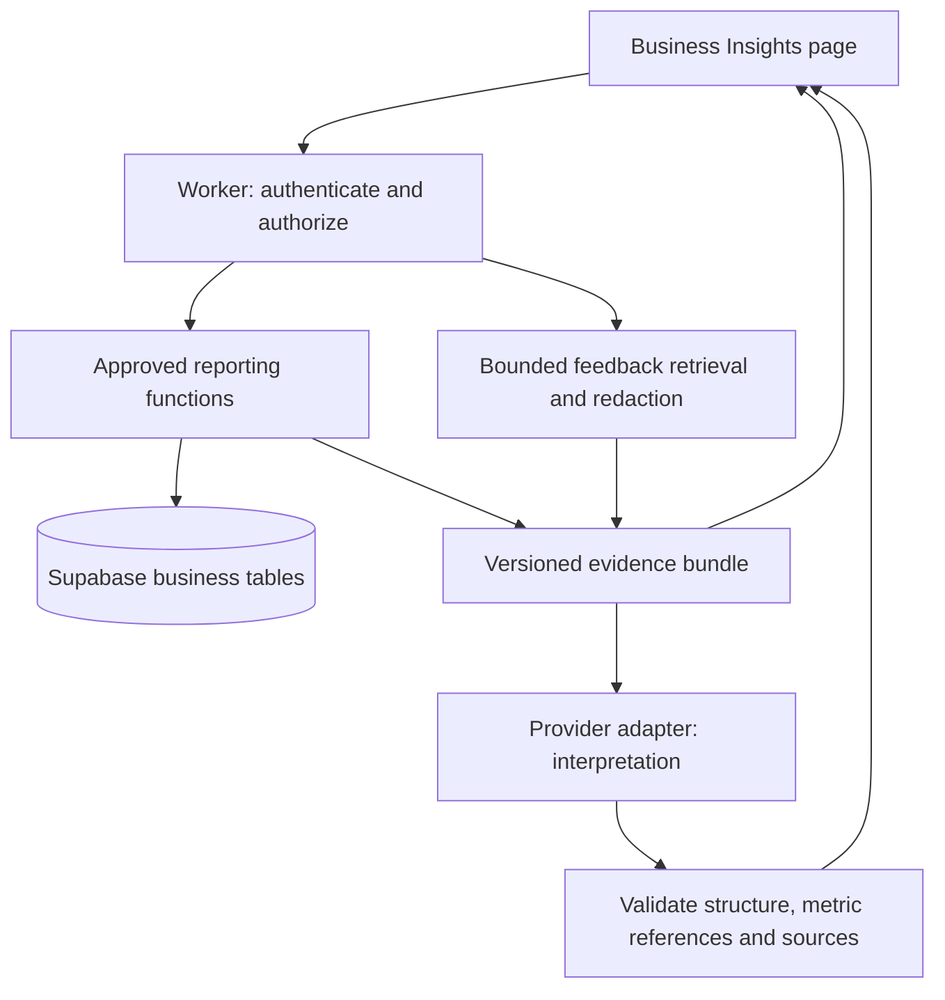

# NGL Business Assistant — product and implementation plan

Status: proposed design, 20 September 2026. No application changes or deployment authorized by this document.

This supersedes ADMIN_INSIGHTS_PLAN.md. Based on local source and migrations, not a live database audit. Data volumes, deployed migrations, provider configuration, and historical completeness remain unverified.

## 1. Product direction

An owner-facing assistant inside the existing admin portal that helps answer: What changed? What deserves attention? What evidence supports that? What should I investigate or do next?

Working name: **Business Insights** in navigation; **NGL Business Assistant** on the page.

Proposed initial defaults, pending owner preference: balanced coverage of sales, inventory, expenses, customer feedback, and basic operations; active superadmin access only. This feature's restriction does not change access to existing admin pages.

The first release analyzes and recommends. It does not change prices, purchase inventory, issue refunds, send customer messages, or execute operational tasks. A personal assistant means it uses NGL's data and an owner-editable business profile; it does not require training a proprietary model.

Success means the owner can inspect an answer, understand its limits, and choose a next step. Fluent prose alone is not success.

## 2. First-release experience

Add Business Insights immediately below Dashboard. Reuse the existing sidebar, typography, theme variables, currency formatting, and responsive conventions.

Desktop page structure:

| Area | Contents and behavior |
|---|---|
| Header | Business Insights; brief explanation; last refreshed time; Refresh |
| Filters | Last 30 days default; 7 days, month to date, custom; previous equal period comparison; all/online/POS channel |
| Metric strip | Confirmed merchandise sales, merchandise gross profit, recorded operating result, orders; comparison and definition accessible on each |
| Attention list | Up to three evidence-backed issues ranked by explicit rules, with priority reason; no forced issue when none qualifies |
| Main analysis | Current answer or initial business brief; findings, possible explanations, suggested next steps, limitations |
| Evidence panel | Metric definitions, dates, counts, source records, data coverage; selected evidence opens here |
| Question composer | Persistent labeled input, Send, example questions, visible active filters |

On mobile: filters collapse into a labeled control, metric cards stack in two columns or one on narrow screens, evidence opens in an accessible sheet, and the composer stays reachable without hiding the answer. Keyboard focus returns to the originating evidence button on close. Announce loading and error states without repeatedly reading the whole conversation.

No animated typing of numbers. Render authoritative metric cards separately from generated narrative. Text and icons accompany positive/negative colors. A falling expense can be favorable; colors must depend on the metric, not simply the sign.

Starter questions:

- How did the business perform compared with the previous period?
- Which products contribute the most gross profit?
- Which products should I review for restocking?
- What changed in our recorded operating result?
- What concerns appear most often in customer feedback?
- Which pending orders and overdue tasks need attention?

Example response structure, using placeholders rather than invented business data:

> **Finding:** Merchandise gross profit changed by [verified amount] over [period].
> **Evidence:** [sales change], [discount change], and [recorded product cost change]. Each figure opens its evidence.
> **Possible explanation:** [hypothesis], clearly separated from measured facts.
> **Suggested next step:** [specific action or investigation].
> **Limit:** Shipping costs/refunds/other records are incomplete where applicable.

Follow-up example: “Only online orders” reruns the analysis with that filter and shows the change; “why?” retains the previous scope. If a question conflicts with the visible filters, clarify or explicitly display the interpreted scope before presenting results.

## 3. Required UI states

| State | Behavior |
|---|---|
| First visit | Load metrics and initial brief; show starter questions |
| Loading | Keep previous result labeled with its original timestamp; prevent duplicate submission |
| Empty period | Show zero recorded activity where valid; do not equate missing data with zero |
| Limited data | Explain the missing fields, affected metrics, and next useful collection step |
| AI timeout / quota | Keep verified metrics visible; distinguish temporary failure from quota; offer retry when appropriate |
| Reporting failure | Do not generate a business answer from memory; identify unavailable data |
| Expired session / access removed | Stop requests, hide results, return to sign-in or access-denied state |
| Invalid AI output | Show verified data and a brief explanation; do not render unchecked claims |

First-release conversations are session-only, with Clear conversation. No cross-device history promise. Follow-ups use bounded context and reauthorize/requery every request. Saved briefs and decisions belong to a later phase.

## 4. Scope and data availability

| Domain | Existing sources | Initial capability | Limit / additional work |
|---|---|---|---|
| Sales | orders, order_items | Comparable period totals, channel and collection/product performance, discounts | Confirm status semantics and historical costs |
| Inventory | products, inventory | Current stock, threshold alerts, observed sales velocity, slow movers | No reliable historical stockouts or supplier lead times identified |
| Expenses | expenses | Category changes and recorded operating result | Completeness and classification require owner review |
| Customers | Contact fields on orders | Estimated repeat-purchaser share among identifiable buyers | Missing POS identities, changed/shared contacts; no reliable universal customer ID |
| Feedback | support_messages, contact_messages, reviews, community_posts | Supported themes, counts within analyzed sample, evidence excerpts | Redaction, deduplication, moderation bias, source coverage |
| Operations | orders, admin_tasks, support_conversations | Pending-order age, overdue/open tasks, unresolved support queue | updated_at is not a status-transition timestamp |

Deferred: campaign ROI, conversion funnels, customer lifetime-value forecasts, exact reorder quantities, delivery-duration analysis, cash-flow forecasts, automated purchasing, and causal claims about what made sales change. These require additional data or stronger evaluation.

## 5. Metric contract — implement before AI

All reports carry metric_version, as_of, timezone=Asia/Manila, currency=PHP, included statuses, period bounds, comparison bounds, filters, source counts, and quality flags. SQL numeric calculations or integer centavos preserve currency precision; display rounding is deterministic.

Proposed status policy: online processing/shipped/delivered and POS completed count as confirmed activity. Pending remains pipeline; cancelled/voided excluded. This is provisional until the owner confirms processing means payment verified. Do not invent a paid status: local constraints contain pending, processing, shipped, delivered, cancelled, completed, voided.

Historical reporting initially groups by order creation time and current status. Label this basis explicitly: without payment/status events, this cannot represent exact cash receipt dates or reproduce an immutable past status report. Add event history later rather than reconstructing it from updated_at.

| Metric | Definition / edge cases |
|---|---|
| Merchandise sales | Confirmed line subtotals minus effective order discounts, excluding shipping collected; reconcile to authoritative order fields |
| Shipping collected | Separate component, never silently mixed into merchandise margin |
| Gross profit | Merchandise sales minus cost captured on sold order items; preserve negative values; flag missing/unverified zero costs |
| Recorded operating result | Gross profit + shipping collected - recorded expenses, with shipping/packaging classification checked for duplication; label as an estimate from recorded data, not audited net profit |
| Average order value | Merchandise sales / confirmed order count, excluding shipping; null if no orders |
| Product margin | Allocate effective order discount in proportion to line revenue; deterministic rounding residual makes line totals reconcile to order totals; use historical item costs |
| Period change | Absolute change; percentage null with explanation if baseline is zero; matched elapsed periods for month-to-date; explicit date bounds |
| Sales velocity | Confirmed units / calendar days in window, including zero-sales days; cannot correct for historical out-of-stock periods yet |
| Estimated stock cover | Current stock / observed daily velocity; null for zero velocity; heuristic, not a delivery/reorder promise |
| Slow movers | Products with stock and no confirmed units in previous 90 days, excluding products younger than 90 days; flag missing history |
| Repeat-purchaser share | Identifiable buyers purchasing in period who have an earlier confirmed purchase / identifiable buyers in period; report identity coverage and historical start date |
| Customer matching | Prefer normalized email; fallback to normalized phone when email absent; no name-based matches or silent cross-contact merges; keep identifiers inside database |
| Pending-order age | as_of - created_at for currently pending orders; does not represent time spent in every status |
| Feedback theme share | Distinct analyzed feedback units tagged with theme / distinct analyzed units; source breakdown and sample coverage; themes may overlap |

Refund-adjusted profit remains unavailable until refund data is captured. Review expenses for inventory purchases already represented in cost of goods sold. Product-level shipping and operating-cost allocation is not implied by product gross margin.

Fix the dashboard's pending-order inclusion, mixed UTC/Manila boundaries, and zero-clamped losses as part of the reporting implementation, not as changes in this planning task. Reconcile against fixtures and source records rather than treating the existing dashboard as ground truth. Aggregate in SQL to avoid client row-limit truncation.

## 6. Architecture



Keep Vite, vanilla JavaScript, Cloudflare Worker, and Supabase. Add an insights handler alongside support; do not share customer-support authorization or conversation tokens.

Use a compact default snapshot plus approved parameterized reports for follow-ups. No model-generated SQL or arbitrary table names/URLs. Example tools: business_overview, product_performance, inventory_attention, expense_breakdown, customer_summary, operations_backlog, feedback_evidence. Each has a strict schema and bounded date range/result size.

Proposed request flow:

1. Browser sends Bearer Supabase access token, question, selected filters, and bounded conversation context to POST /api/insights.
2. Worker validates identity against Supabase Auth and verifies active superadmin status server-side on every request. Client-supplied roles are ignored.
3. Validate request size, filters, per-user quota, and supported scope. Model-assisted intent selection may choose only allowlisted reports with validated arguments.
4. Call reporting RPCs under the caller JWT. Database functions independently enforce the feature's superadmin gate. Prefer security invoker where possible; narrowly scoped security definer functions may be necessary for restricted sources, with explicit role guard, fixed search path, qualified names, and restricted execute grants.
5. Fetch a bounded set of relevant feedback, redact sensitive content before provider egress, and record coverage. Build the evidence bundle.
6. Send only necessary evidence and sanitized context to the provider. No browser database keys, raw customer contacts, authentication tokens, payment proofs, or unrestricted records in prompts.
7. Validate response schema and references, resolve numeric placeholders from evidence server-side, reject unsupported numeric claims, and fall back to verified metrics if validation fails. This reduces fabrication risk; it does not prove all generated explanations correct.
8. Return answer, authoritative metrics, evidence, coverage, interpreted scope, and as_of. Use Cache-Control: no-store for private HTTP responses. Operational logs omit raw conversations, prompts, and customer records.

Do not call an auth.uid()-gated RPC using only the service-role identity: that loses the owner identity the guard expects. Background jobs, if added, need a separately designed restricted authorization path.

## 7. Evidence and answer contract

Evidence entries contain stable IDs, metric key/value/unit, period and filters, calculation version, source type, source count, and authorized drill-down reference. Record IDs remain internal; public links are not generated.

The AI response contains findings with evidence IDs; labeled hypotheses; proposed next steps with reason and success measure; and limitations. Numeric facts reference supplied metric IDs and are rendered from database values. Arbitrary model-produced URLs and HTML are forbidden. Escape output and resolve links from known source types server-side.

Suggested response envelope:

```json
{
  "request_id": "opaque-id",
  "as_of": "ISO timestamp",
  "metric_version": "v1",
  "scope": {"timezone": "Asia/Manila", "currency": "PHP", "channel": "all"},
  "metrics": [],
  "evidence": [],
  "answer": {"findings": [], "hypotheses": [], "next_steps": [], "limitations": []},
  "coverage": {},
  "warnings": []
}
```

No numerical confidence percentages invented by the model. Use factual labels such as Complete for selected sources, Partial coverage, or Insufficient history, with reasons. A correlation between complaints and sales changes is not proof of causation.

## 8. Customer feedback pipeline

Retrieve customer messages only from support conversations, not AI/admin replies as customer sentiment. Treat a support conversation as one analysis unit; contact submissions and reviews/posts are separate units. Deduplicate known cross-posted reviews by linked order and matching content, without claiming reliable deduplication where links are absent.

Initial thematic categories: quality, sizing/fit, delivery, payment, availability, price/value, service, and other. Allow multiple categories; classification is model-derived and must be evaluated against manually labeled examples.

Use source/date filters and bounded batches before considering embeddings. Do not assume all historical text fits in one prompt. Display analyzed count / eligible count, sampling method, source mix, moderation coverage, and excluded records. Theme summaries refer to the sample unless all eligible units were processed. Preserve access to eligible unpublished complaints in owner-only analysis; do not let public moderation filters silently hide negative feedback.

Customer text is untrusted evidence, never instructions. Strip contact details and payment/order identifiers from excerpts; sanitize owner questions and conversation history too. Redaction can miss unusual identifying text: manually inspect representative egress samples before release, minimize excerpts, and withhold sensitive documents entirely. Do not advertise guaranteed anonymization.

## 9. Personalization and memory

First release: a small owner-editable business profile containing priorities, preferred language, budget constraints, and operational notes. No fabricated profile defaults. Store in a new private insights_settings table, never public store_settings. Proposed fields: owner_id, profile jsonb with validated keys, updated_at; owner-only RLS and role check. Profile editing is an explicit user save, not an AI capability.

Session follow-ups are supported from launch. Later: saved briefs, editable decisions, review dates, and outcome tracking. Never infer that accepting a suggestion authorizes execution. Expanding access beyond owners requires an explicit access matrix for profit, customer evidence, and saved conversations.

## 10. Provider, cost, and limits

Provider-neutral adapter. Evaluate the existing Gemini integration and Workers AI on identical anonymized NGL cases; select on correctness, refusal when data is absent, privacy configuration, latency, and measured cost. Model availability and terms must be verified at implementation. No fixed model, free-use promise, or daily question estimate is committed in this plan.

Proposed configurable starting limits: 4,000 characters/question, 12 retained conversational messages with a total byte cap, four report calls/request, 12-month maximum financial query window, 30-second overall deadline, five requests/minute/owner, and a shared daily cost/request cap. Customer historical matching can run an aggregate over older history without exporting raw records. Limit and report feedback batch coverage independently.

Use atomic server-side usage reservations, not process-local counters. A private insights_usage table can store owner, request ID, time, status, provider/model, token usage, and estimated cost without raw prompt text. Bounded retries must respect the original reservation/deadline. Initial retention proposal: 30 days of operational usage, subject to owner review. Provider failure must not trigger an unlimited fallback chain.

Production selection includes review of provider retention/data-use settings for business data and an explicit operating budget. Cache derived metrics only with complete authorization/scope keys and short TTL; never allow public/shared edge caching of responses.

## 11. Delivery plan and acceptance gates

| Phase | Deliverable | Exit criteria |
|---|---|---|
| 0 — design and data audit | Review this plan; audit deployed schema, volumes, status/payment meaning, costs, expenses, feedback coverage | Agreed metric definitions and access; documented missing data; provider budget decision scheduled |
| 1 — reporting foundation | Versioned reporting functions, source evidence, shared dashboard calculations | Known fixtures reconcile to centavos; losses visible; pending excluded appropriately; Manila boundaries and partial periods correct; no client-row truncation |
| 2 — interface and financial assistant | Insights page, brief, follow-ups, filters, evidence, owner profile, provider adapter | Unauthorized calls fail at API and RPC; numeric references validate; useful results survive AI outage; filters remain consistent |
| 3 — customer and operations coverage | Feedback themes, repeat-buyer estimate, task/order/support backlog | Redaction/coverage checks pass; no customer instructions executed; unknown identities visible; theme quality reviewed |
| 4 — owner pilot | Representative real questions and corrected gaps | Owner can trace findings to sources; no unsupported quantified claims in release suite; budget/deadline limits enforced |
| Later — proactive assistant | Scheduled in-app briefs, saved decisions and outcome review | Separate design for scheduling, permissions, retention, and optional notifications |

First-release scope is complete through Phase 4; Phase 2 is an internal milestone, not completion of customer-data analysis. Do not promise calendar estimates until deployed-data audit and provider evaluation are done.

Required evaluation cases: negative profit; cancelled and pending orders; POS completed; order-level discount rounding; zero previous-period sales; missing item costs; Manila midnight; partially completed month; absent POS identity; duplicate feedback; sparse history; zero sales velocity; prompt injection in a customer message; unknown source citation; stale/inactive owner token; direct unauthorized RPC; empty database; reporting failure; provider timeout; concurrent quota requests.

Create a manually verified set of at least 20 representative business questions with expected source facts and acceptable limitations. Arithmetic checks must pass exactly; generated theme/hypothesis quality is manually scored and failures recorded. Performance target: metrics visible within 3 seconds and most answers within 15 seconds on representative data, treated as targets to measure rather than promises.

## 12. Planned files — implementation only after design review

- admin/insights.html; src/insights.js; src/insights.css.
- functions/api/_insights-core.js and a small provider adapter.
- worker.js route; vite.config.js page/dev route; src/admin.js navigation.
- New Supabase migrations for reports, guarded helpers, private profile and usage records.
- Shared report consumption in src/dashboard.js / src/supabase.js where necessary to correct inconsistent metrics.
- Tests for report reconciliation, permissions, response validation, feedback handling, limits, and critical UI states.

No embeddings database, fine-tuning job, new frontend framework, or autonomous write tools required for the first release.

## 13. Decisions to review with the owner

1. Priority: balanced business view versus inventory-first or profit-first. Draft default: balanced.
2. Access: owner-only versus all active admins. Draft default: active superadmin only.
3. Does moving an online order to processing confirm payment? Which other payment states exist outside the app?
4. Are product costs and expense records complete, and do expense entries include inventory purchases?
5. Preferred assistant language and operating AI budget. Draft uses the question's language and commits no paid budget.

## References

Local basis: worker.js; wrangler.jsonc; src/admin.js; src/dashboard.js; src/supabase.js; src/pos.js; functions/api/_support-core.js; supabase/migrations/*.sql.

Technical references checked during planning:

- [Supabase database functions](https://supabase.com/docs/guides/database/functions): caller/definer permissions and restricted function execution.
- [Cloudflare Workers AI bindings](https://developers.cloudflare.com/workers-ai/configuration/bindings/): integration into an existing Worker.
- [Cloudflare Workers AI pricing](https://developers.cloudflare.com/workers-ai/platform/pricing/): verify current model-specific costs during selection; do not reuse the previous plan's estimated daily question allowance.
