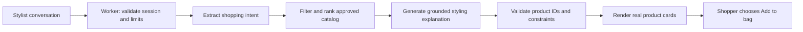

# NGL Stylist — conversational shopping design

Status: proposed design, 20 September 2026. Planning only; no application changes in this task.

This replaces the customer-facing product direction in STYLIST_PLAN.md and the support-first entry experience in SUPPORT_BOT_PLAN.md. The admin Business Assistant remains a separate internal feature; stylist requests never access sales, margins, customer lists, or business reports.

## Product concept

**NGL Stylist** helps shoppers choose jewelry for their occasion, outfit, preferences, budget, and practical needs. It should feel like a thoughtful shop assistant: ask a useful question when needed, offer a small selection, explain the choices, and help refine them.

The main entry is the existing floating chat, renamed **Ask a stylist**. A shop-page “Help me choose” button opens the same experience. Do not add a competing third shop mode or a second floating bubble.

Style direction: use NGL's existing ivory, gold, typography, and theme tokens; editorial product photography; restrained borders; readable chat copy. Product cards get more visual space than chat bubbles. Avoid help-desk avatars, “usually replies instantly,” artificial urgency, and excessive sparkle animation.

Clearly identify the assistant as AI in the header subtitle: “AI jewelry guide.” No login, name, or email required to browse recommendations.

## Opening experience

Header: **NGL Stylist**

Welcome: **What are you dressing for?**

Supporting copy: “Tell me about your occasion, outfit, or budget. I'll help you find pieces that suit you.”

Starter chips:

- Wedding guest
- Everyday essentials
- Office looks
- Date night
- Help me choose a gift
- Under ₱1,000

Input placeholder: “A necklace for a black dress, under ₱800…”

Small secondary link: **Help with an order**. Order tracking and customer-service contact remain discoverable through that route; they do not dominate the stylist opening.

## Conversation behavior

Understand requests about occasions (weddings, graduations, birthdays, parties), use cases (daily wear, office, travel, gifts), outfit details (color, neckline, simplicity), preferences (minimal, bold, metal color, category), and budgets in PHP.

Use constraints the shopper already supplied. Ask at most one useful clarifying question per turn, and recommend immediately when the request is sufficiently clear. Budget need not be mandatory; when absent, show transparent prices across a modest selection. Do not ask shoppers to complete a survey before seeing products.

Return one to three relevant products by default. A shopper asking for earrings should see earrings; a shopper requesting a complete look can receive a coordinated set. Do not force every request into three pieces or assume the shopper must buy a set.

Each recommendation contains product photo, real name, current price, one concise styling reason, View item, and Add to bag. A requested set shows its item subtotal and labels shipping as separate unless an authoritative applicable shipping calculation is available. A total budget applies across the proposed set, not independently to each item.

Useful refinement chips depend on context: More subtle, More statement, Lower price, Show another option, Build a full look. Preserve the occasion, outfit, exclusions, and budget across follow-ups. “Start over” clears the current style brief. Reply in the shopper's language, including natural English/Filipino code-switching when used.

Explain recommendations through verified attributes and styling judgment: “This simpler shape would keep attention on your dress.” Avoid invented popularity, discounts, materials, comfort, or durability claims. Do not label an item a bestseller without an approved public merchandising attribute.

### Illustrative exchange — no live catalog claims

Shopper: “Wedding guest ako, sage green dress, budget ₱1,000.”

Stylist: “Do you want one statement piece or a simple matching pair of pieces?”

Shopper: “Simple lang, earrings and bracelet.”

Stylist: “I'd keep the shapes understated so they complement your dress. Here are options within your total budget.”

Display eligible catalog cards with real prices; if no pair fits, say so and offer a single item or ask whether the shopper wants to change the budget. Never fabricate a qualifying pair.

Shopper: “May mas mura?”

Stylist retains sage dress, wedding, simple styling, earrings/bracelet, and the total-budget interpretation, then offers a lower-priced eligible combination if one exists.

## Screen design and states

| Area | Desktop | Mobile |
|---|---|---|
| Launcher | Labeled Ask a stylist button at lower right | Compact labeled button positioned clear of cart controls |
| Panel | Approximately 420px wide, viewport-bounded height | Near-full-screen sheet with safe-area padding |
| Header | Name, AI label, Start over, Close | Same controls with accessible touch targets |
| Body | Welcome chips or conversation with stacked product cards | Stacked product cards; no tiny nested horizontal carousel |
| Brief | Editable chips for supplied occasion, budget, and preference | Wrap/collapse without hiding the budget |
| Composer | Labeled textarea and Send | Keyboard-aware composer; no overlap with last message |
| Secondary help | Help with an order | Same link; route clearly out of stylist mode |

Support keyboard navigation, Escape to close, focus return, reduced motion, visible focus, labeled buttons, and restrained live-region announcements. Show real progress while fetching; no artificial loading delay.

States to design: first open, clarification, recommendations, refinement, empty match, missing product facts, stock/price changed, network failure, AI unavailable, cart update success/failure, expired session, and handoff to order help.

If AI is unavailable, offer explicit filters for occasion/category/budget and deterministic catalog picks labeled “Browse matching pieces.” Do not pretend a failed AI request understood an unparsed prompt. If catalog retrieval fails, show retry and the shop link, not stale availability claims.

## Recommendation architecture

Use a new /api/stylist branch in worker.js and a shared stylist core. The repository currently uses a Cloudflare Worker entry point; a Pages-style file alone will not create a production route. Verify the current development route wiring when implementation starts because support files are being edited independently.

The server reads only approved public merchandising fields and stock eligibility. Exclude cost_price, order data, customer contacts, and admin-only settings. No model-generated SQL or arbitrary database tools.

The model extracts structured constraints and provides phrasing; deterministic code enforces category, active/in-stock status, exclusions, and budget. Rank using curated metadata and explicit preferences. The response identifies products by database ID; code resolves names, images, links, prices, and availability from the catalog. Validate explanations against verified product attributes.

Product availability is a snapshot, not a reservation. Recheck on add-to-bag where feasible and keep checkout's authoritative stock/price validation. Show price changes and ask shoppers to review changed totals. Only the shopper's explicit button action adds products to the bag.

Do not accept the browser's catalog, price, or conversation instructions as authoritative. Bound history and request length; validate anonymous session ownership, rate limits, and shared daily usage budget. Keep provider secrets server-side. Provider selection remains configurable; no guaranteed free quota.

## Catalog readiness

Existing products have name, collection, category, description, tags, price, image, active status, and inventory relation. Audit actual data completeness before implementing ranking.

Proposed owner-editable metadata: occasions, style_tags, color/finish, visual prominence, dimensions/length, adjustable fit, verified material, verified care instructions, and verified functional claims. Store optional structured metadata in a new style_meta field with a validated schema and admin editor.

Curated style annotations can be subjective; physical properties require an authoritative supplier/owner source. AI may draft metadata for review but must not publish factual product claims automatically.

Critical distinction: recommending beach-inspired styling does not mean jewelry is safe in saltwater. Sweat resistance, waterproofing, hypoallergenic suitability, weight/comfort, nickel content, and plating durability remain unknown unless verified. For a sensitive-skin or swimming request, explain the missing specification and offer verified alternatives or human help. Do not infer these properties from collection names or photos.

Unknown metal color, size, or required material cannot satisfy a hard constraint. Explain the gap rather than quietly ignoring it. Styling suggestions should not assume gender, skin tone, body type, or age; ask about recipient taste when helpful for gifts.

## Relationship to existing support

Replace the support branding and opening with stylist discovery. Preserve existing support conversations and admin queue during migration; do not reinterpret old support history as shopping preferences.

Use a separate stylist session namespace and endpoint. Initial stylist history is session-only with Start over and no cross-device memory. Opening order help switches to the existing authenticated-by-conversation-token support flow or order-tracking page; no account-wide order search is available to the stylist.

Requests such as “Where is my order?” receive a clear order-help route. Refund or complaint handling follows that support route; do not respond with a sales pitch. A shopper asking for a human can open existing contact/live support without promising instant availability. Share a styling brief with support only through an explicit shopper action.

## Optional merchandising insights

After the basic experience works, measure structured events: stylist opened, recommendation shown, product viewed, add-to-bag, no-match, and fallback. Proposed data: event type, product IDs, coarse occasion, budget band, timestamp, and short-lived session ID. Avoid storing raw chats by default; decide retention and tracking disclosures before enabling analytics.

Aggregate unanswered requests can inform the separate owner Business Assistant: for example, demand for a category absent from the catalog. Label this as requests among stylist users, not overall market demand. Purchases following recommendations are observational attribution, not proof the stylist caused them.

## Build sequence

1. Review this conversation/UI design and audit catalog attributes and cart integration.
2. Build a reviewable desktop/mobile prototype with clearly marked sample products, including no-match and refinement states.
3. Implement deterministic catalog filtering/ranking and constraint tests; curate initial metadata.
4. Add the stylist Worker route, bounded conversation context, provider adapter, validation, fallback, and usage controls.
5. Replace the storefront chat entry; integrate real product cards and shared cart behavior across pages. Keep support migration explicit.
6. Pilot against real catalog examples, refine copy/ranking, and release behind a feature flag with a reversible switch to the previous widget.

Acceptance cases: occasion + outfit + budget; Filipino follow-up; gift without size information; one-item request; set total budget; no eligible stock; unavailable required material; request for waterproof/sensitive-skin suitability; changed price; deleted product; repeat add-to-bag; prompt injection; AI outage; unknown product ID; support handoff; mobile keyboard; keyboard-only navigation. Recommendations must never exceed a stated hard budget or include an ineligible product at validation time.

First release excludes photo uploads, virtual try-on, persistent personal profiles, unsolicited messages, autonomous cart changes, and admin business-data access. Outfit photos can be designed later with upload/privacy requirements and explicit limits on visual inference.

## Implementation touchpoints

Review src/support-widget.js and its styles for replacement/reuse; add stylist-specific frontend/core files and worker.js routing. Extract/reuse the real cart interface from src/shop.js instead of maintaining a second cart format. Register any required development routing in vite.config.js after inspecting its current state. Add metadata migration/editor only if catalog audit justifies the proposed fields.

Keep NGL_BUSINESS_ASSISTANT_PLAN.md as the plan for the owner-facing analyst. This document governs customer-facing stylist discovery.
